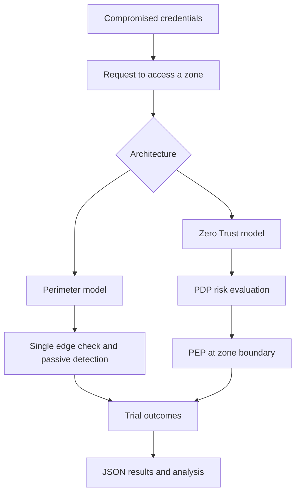

# Zero Trust vs Perimeter Security Simulation

A Python-based stochastic simulation comparing a traditional perimeter-trust model with a Zero Trust model during a credential-compromise and lateral-movement scenario.

The simulation models an attacker using compromised credentials and attempting to reach a core banking data zone. It runs repeated trials and records detection, containment, and response-related outcomes.

## Scope and implementation boundary

This repository is a **software simulation**, not a live Zero Trust deployment, penetration test, or measured assessment of a real bank. Risk signals, thresholds, attacker behaviour, and response delays are assumptions encoded in the model. Results should be interpreted as outputs of those assumptions, not as predictions of real-world security performance.

## Models compared

### Perimeter model

- A single authentication checkpoint is modelled at the network edge.
- A session is treated as trusted after successful login.
- Lateral movement is not re-evaluated at each zone transition.
- Detection is represented by a stochastic passive-review delay.
- Response requires a separately modelled manual delay.

### Zero Trust model

- Each request is evaluated by a Policy Decision Point (PDP).
- The risk score combines identity confidence, device posture, and behavioural consistency.
- Zone transitions are checked by Policy Enforcement Points (PEPs).
- Requests above the configured risk threshold are flagged and blocked in the simulation.

## Architecture



## Repository contents

| File | Purpose |
|---|---|
| `simulation.py` | Runs the primary comparison over 1,000 trials and writes JSON results |
| `sensitivity.py` | Evaluates alternative risk thresholds over attack and legitimate-user trials |
| `simulation_results.json` | Stored output from the primary simulation |
| `sensitivity_results.json` | Stored output from threshold sensitivity analysis |

## Requirements

- Python 3.10 or later
- Python standard library only

## Run the simulation

From the repository root:

```bash
python simulation.py
python sensitivity.py
```

The scripts print JSON-formatted results and write their respective output files.

## What is measured

The primary simulation records outcomes such as:

- Detection time, measured in abstract simulation steps
- Whether the attack was contained before reaching the target zone
- Whether the attacker reached the target zone
- Response time after detection

The sensitivity analysis varies the PDP risk threshold and records:

- Simulated attack containment rate
- Simulated legitimate-user false-positive rate

A lower or higher threshold changes the trade-off between blocking suspicious activity and interrupting legitimate sessions.

## Important interpretation notes

- A simulation step is not a real-world second, minute, or hour.
- Model outputs depend on the distributions, weights, thresholds, and scenario logic in the Python source.
- The model uses synthetic attack and legitimate-user behaviour; it does not ingest real identity, device, or network telemetry.
- The code does not enforce policies in Microsoft Entra ID, Azure Firewall, Kubernetes, or any production network.
- Results should not be presented as empirical proof that Zero Trust always outperforms perimeter security.

## Engineering improvements

1. Add unit tests for the risk-scoring and trial functions.
2. Add confidence intervals across repeated simulation seeds.
3. Make model parameters configurable rather than hard-coded.
4. Separate scenario assumptions from simulation logic.
5. Add charts for containment and false-positive trade-offs.
6. Add a CI workflow to run tests and validate generated result schemas.

## Author

**Kelvin Arigbe**  
Cloud Security | Zero Trust | Python

[GitHub profile](https://github.com/KelvinArigbe)
